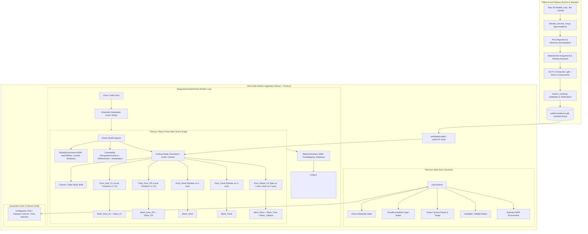
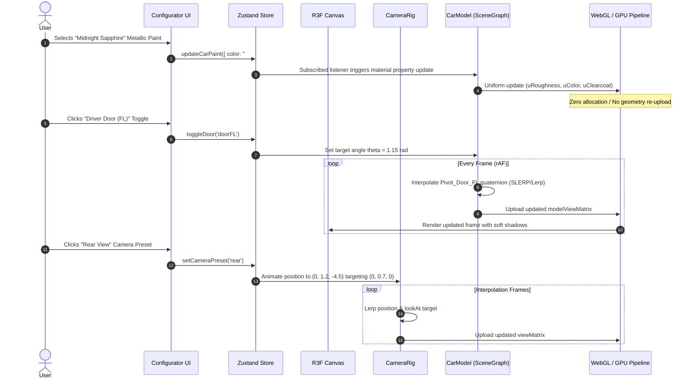

# Technical Architecture & System Specification

## 1. Executive Technical Summary

The **3D Car Model and Viewer** is an interactive, academic-grade Computer Graphics application combining an automotive showcase and a real-time vehicle configurator. The system is split cleanly into two distinct operational subsystems:
1. **Offline / Development Asset Preparation Pipeline:** An automated Python/Blender pipeline responsible for inspecting, cleaning, pivoting, optimizing, and validating 3D automotive models into standardized Khronos GLTF 2.0 Binary (`.glb`) assets.
2. **Client-Side Real-Time Rendering Engine:** A modern WebGL/WebGPU-ready frontend engineered with **React 19**, **Vite**, **Three.js**, **React Three Fiber (R3F)**, **Drei**, and **Zustand**, providing 60 FPS physically-based rendering, dynamic lighting, kinematic component animations, and an automotive HUD.

---

## 2. System Architecture & Data Flow



---

## 3. Separation of Concerns & Subsystem Responsibilities

| Responsibility | Technology Stack | Rationale |
| :--- | :--- | :--- |
| **Asset Pivot Alignment & Sanity Check** | Python 3, Blender `bpy`, `pygltflib` | Ensures mesh geometry center offsets are converted to mechanical hinge pivots before entering the browser. |
| **Mesh Optimization & Geometry Packing** | Draco / Meshopt, Blender GLTF Exporter | Reduces bandwidth and GPU buffer consumption. |
| **PBR Material Construction & Shader Setup** | Three.js `MeshPhysicalMaterial`, Custom PBR nodes | Provides realistic automotive clearcoat, metallic flakes, anisotropic reflection, and physical glass transmission. |
| **Scene Graph & Render Loop** | React Three Fiber (R3F), Three.js | Declarative, component-based scene graphs with explicit lifecycle handling and native WebGL performance. |
| **Camera View Matrix & Transitions** | `@react-three/drei` (OrbitControls), GSAP / Spring Lerp | Mathematical interpolation of camera position vector $\vec{P}$ and look-at target vector $\vec{T}$. |
| **State Coordination** | Zustand | Non-reactive to canvas re-mounts; allows high-frequency UI updates without tearing down the WebGL context. |
| **User Interface & Layout** | React 19, CSS Modules / Modern CSS | Accessible, responsive automotive showroom controls overlaid over the 3D canvas. |

---

## 4. 3D Model Hierarchy & Component Rigging Specification

Standard raw car models downloaded from 3D repositories typically consist of flat, single-mesh objects or arbitrary hierarchies with centers placed at the world origin `(0, 0, 0)`. **Such models cannot be rotated or animated correctly without mathematical transformation rigging.**

### The Pivot-Mesh Assembly Pattern
To allow independent door opening, bonnet tilting, boot lifting, and wheel rotation, each movable part must follow a strict two-node parent-child pattern:
1. **Pivot Node (`Object3D` / Empty):** Placed exactly at the physical hinge axis or rotation center.
2. **Mesh Node (`Mesh`):** Child of the pivot node, containing vertex data displaced relative to the hinge axis.

```
Car_Root [Root position / world orientation]
  |-- Chassis_Body_Static [Fixed chassis, interior dashboard, seats, engine block]
  |-- Pivot_Door_FL [Positioned at Front-Left hinge vector (hx, hy, hz)]
  |     `-- Mesh_Door_FL [Mesh geometry relative to hinge]
  |     `-- Glass_Door_FL [Transparent window geometry]
  |-- Pivot_Door_FR [Positioned at Front-Right hinge vector (hx, hy, hz)]
  |     `-- Mesh_Door_FR [Mesh geometry relative to hinge]
  |     `-- Glass_Door_FR [Transparent window geometry]
  |-- Pivot_Door_RL [Positioned at Rear-Left hinge vector]
  |     `-- Mesh_Door_RL
  |-- Pivot_Door_RR [Positioned at Rear-Right hinge vector]
  |     `-- Mesh_Door_RR
  |-- Pivot_Bonnet [Positioned at hood top hinge axis]
  |     `-- Mesh_Bonnet
  |-- Pivot_Boot [Positioned at trunk roof hinge axis]
  |     `-- Mesh_Boot
  |-- Wheel_Assembly_FL [Positioned at front-left wheel hub center]
  |     |-- Steer_Pivot_FL [Rotates around local Y-axis for steering]
  |           `-- Spin_Pivot_FL [Rotates around local X/Z-axis for driving spin]
  |                 |-- Mesh_Rim_FL
  |                 |-- Mesh_Tire_FL
  |                 `-- Mesh_BrakeDisc_FL
  |-- Wheel_Assembly_FR ...
  |-- Wheel_Assembly_RL ...
  |-- Wheel_Assembly_RR ...
  |-- Lights_Group
  |     |-- Headlight_L [SpotLight / PointLight + Emissive Mesh]
  |     |-- Headlight_R
  |     |-- Taillight_L [Emissive Mesh + PointLight]
  |     `-- Taillight_R
  `-- Glass_Static_Group [Windshield, Rear Window, Sunroof]
```

### Mathematical Formulation for Component Rotation
For any door hinge with local origin $\mathbf{O}_h$ and unit rotation axis $\hat{\mathbf{u}}$, a rotation by angle $\theta(t)$ is computed using Rodrigues' rotation formula or Quaternion formulation:
$$\mathbf{q}(t) = \left[ \cos\left(\frac{\theta(t)}{2}\right), \hat{\mathbf{u}} \sin\left(\frac{\theta(t)}{2}\right) \right]$$
During the render loop, $\theta(t)$ is smoothly interpolated using exponential easing or cubic smoothstep:
$$\theta(t + \Delta t) = \text{lerp}(\theta(t), \theta_{\text{target}}, 1 - e^{-k \Delta t})$$
This guarantees frame-rate-independent, mathematically smooth motion.

---

## 5. Standard Component Naming Conventions

All assets passing through the pipeline must adhere to the standardized semantic naming contract:

| Category | Node Name Pattern | Three.js Material Type | Notes |
| :--- | :--- | :--- | :--- |
| **Car Body** | `Body_Paint_Exterior` | `MeshPhysicalMaterial` | Clearcoat $= 1.0$, Roughness $\in [0.1, 0.4]$, Metalness $\in [0.7, 0.95]$ |
| **Car Body Plastic** | `Body_Trim_Plastic` | `MeshStandardMaterial` | Roughness $= 0.8$, Metalness $= 0.05$ (Bumpers, diffusers) |
| **Front Doors** | `Pivot_Door_FL`, `Pivot_Door_FR` | `Object3D` | Rotates outward on vertical axis ($\pm Y$ or local hinge vector) |
| **Rear Doors** | `Pivot_Door_RL`, `Pivot_Door_RR` | `Object3D` | Rotates outward |
| **Hood / Bonnet** | `Pivot_Bonnet` | `Object3D` | Rotates upward on horizontal hinge axis |
| **Trunk / Boot** | `Pivot_Boot` | `Object3D` | Rotates upward on rear hinge axis |
| **Wheels** | `Wheel_Assembly_[FL\|FR\|RL\|RR]` | Hierarchical Assembly | Hub center at geometry centroid |
| **Rims** | `Mesh_Rim_[FL\|FR\|RL\|RR]` | `MeshStandardMaterial` | Configurable chrome, gloss black, or brushed aluminum |
| **Tires** | `Mesh_Tire_[FL\|FR\|RL\|RR]` | `MeshStandardMaterial` | Rubber roughness $= 0.9$, normal map tread pattern |
| **Brake Calipers**| `Mesh_Caliper_[FL\|FR\|RL\|RR]`| `MeshStandardMaterial` | Custom accent paint (Red, Yellow, Cyan, Gold) |
| **Glass** | `Glass_Windshield`, `Glass_Door_*` | `MeshPhysicalMaterial` | Transmission $= 0.95$, IOR $= 1.52$, Roughness $= 0.05$, Transparent |
| **Lights (Front)**| `Light_Headlight_[L\|R]` | `MeshStandardMaterial` | Emissive color with high intensity, Bloom integration |
| **Lights (Rear)** | `Light_Taillight_[L\|R]` | `MeshStandardMaterial` | Deep red emissive channel |
| **Interior** | `Interior_Chassis_Seats_Dash` | `MeshStandardMaterial` | Leather, dashboard plastic, carbon accents |

---

## 6. Frontend Rendering Pipeline



### Critical WebGL Performance & Lifecycle Safeguards
1. **Memory Disposal Strategy:** Every texture, geometry, and material instance is tracked in an explicit cleanup registry. When hot-reloading or switching model variants, all GPU buffer allocations (`geometry.dispose()`, `material.dispose()`, `texture.dispose()`) are triggered to prevent memory leaks and WebGL context loss.
2. **Selective Rerendering:** UI components are isolated outside the Three.js canvas boundary. State updates pass through direct Three.js object mutations via references (`useRef` + `useFrame`) rather than triggering full React component re-renders.
3. **PBR Lighting Stability:** Environment HDRIs are prefiltered into PMREM (Prefiltered Mipmapped Radiance Environment Map) cubemaps to guarantee smooth microfacet specular reflections without runtime frame drops.

---

## 7. Python & Blender Asset Pipeline Specification

```
[External Sources] (.fbx / .obj / .gltf)
        |
        v
  [1. Python Validator: inspect_model.py]
        | Checks: Triangle count, node names, bounding box, missing textures
        v
  [2. Blender Headless Automation: blender_process_car.py]
        | Transforms origin to ground center (Y-up / Z-up conversion)
        | Identifies door and wheel sub-meshes
        | Re-parents sub-meshes to engineered Pivot Empty nodes
        | Normalizes material slot names
        | Exports sanitized .glb with Draco compression
        v
  [3. Sanity Audit & Report Generation]
        | Checks: File size < 25 MB, zero non-manifold edges, valid GLTF JSON
        v
  [public/models/car.glb Ready for Three.js Loader]
```

### Headless CLI Invocation Pattern
```bash
# Inspection without Blender (using Python pygltflib/trimesh)
python3 python/inspect_model.py --input assets/raw/car.glb

# Full automated rigging and export via headless Blender
blender --background --python python/blender_process_car.py -- \
  --input assets/raw/car_raw.blend \
  --output public/models/car.glb \
  --draco
```

---

## 8. Directory & Component Structure

```
3D CAR MODEL/
|-- assets/
|   |-- raw/
|   |-- processed/
|   `-- textures/
|-- docs/
|   |-- DEVELOPMENT_GUIDELINES.md
|   |-- FEATURE_CHECKLIST.md
|   |-- PROJECT_ARCHITECTURE.md
|   `-- PROJECT_STATUS.md
|-- python/
|   |-- inspect_model.py
|   |-- blender_process_car.py
|   |-- gltf_validator.py
|   `-- requirements.txt
|-- public/
|   |-- models/
|   `-- environments/
|-- src/
|   |-- assets/
|   |-- components/
|   |   |-- canvas/
|   |   |   |-- ShowroomCanvas.jsx
|   |   |   |-- StudioScene.jsx
|   |   |   |-- CarModel.jsx
|   |   |   |-- CarDoors.jsx
|   |   |   |-- CarWheels.jsx
|   |   |   |-- CarLights.jsx
|   |   |   |-- CameraRig.jsx
|   |   |   `-- StudioLighting.jsx
|   |   `-- ui/
|   |       |-- HeaderHUD.jsx
|   |       |-- ConfiguratorPanel.jsx
|   |       |-- PaintColorPicker.jsx
|   |       |-- MaterialFinishes.jsx
|   |       |-- AnimationControls.jsx
|   |       |-- CameraPresetButtons.jsx
|   |       `-- EnvironmentSelector.jsx
|   |-- hooks/
|   |   |-- useCarAnimation.js
|   |   |-- useCameraTransition.js
|   |   `-- useModelLoader.js
|   |-- store/
|   |   `-- useCarStore.js
|   |-- utils/
|   |   |-- materialFactory.js
|   |   |-- sceneGraphHelpers.js
|   |   |-- resourceDisposal.js
|   |   `-- mathUtils.js
|   |-- App.jsx
|   |-- main.jsx
|   `-- index.css
|-- package.json
|-- vite.config.js
`-- README.md
```

---

## 9. Technical Risk Matrix & Mitigation Strategies

| Risk ID | Potential Issue | Impact | Mitigation Strategy |
| :--- | :--- | :--- | :--- |
| **TR-01** | Downloaded car models have baked, unified geometry (doors cannot open). | High | Provide a Python asset validator (`inspect_model.py`) that audits node counts. If an asset is monolithic, utilize Blender bisect/separate operators or select CC-BY modular automotive assets specifically curated for configurators. |
| **TR-02** | Pivot points located at world origin `(0, 0, 0)` causing doors to swing wildly in space. | Critical | Engineered pivot hierarchy (`Pivot_Door_*`) where the local origin is explicitly calculated from the hinge geometry bounding box minimum or custom Blender empty. |
| **TR-03** | WebGL memory leak leading to tab crash when switching materials or HDR environments. | High | Centralized `resourceDisposal.js` that recursively disposes geometry attributes, index buffers, textures, and material programs before unmounting. |
| **TR-04** | Blender executable not in system `PATH` (e.g., standard macOS application path). | Medium | Python scripts provide dual-mode execution: (a) Standalone Python inspection (`pygltflib`, `trimesh`) which works without Blender; (b) Clear CLI detection with `--blender-bin` path parameter. |
| **TR-05** | High polygon count (> 500,000 triangles) causing frame rate degradation below 30 FPS. | High | Enforce a budget of $\le 200,000$ triangles and 25 MB file size; apply Draco geometry compression and level-of-detail (LOD) if necessary. |
| **TR-06** | React re-render thrashing during 60 FPS animation loop. | High | Store high-frequency animation states in Three.js object matrices and mutable refs; only broadcast low-frequency discrete state changes to Zustand. |

---

## 10. Testing & Verification Strategy

1. **Asset Pipeline Verification:**
   - Static analysis of GLB files: check presence of required node names (`Body_Paint`, `Pivot_Door_FL`, etc.).
   - Geometry bounds verification: verify model is centered at origin with tires resting on ground plane ($Y = 0$).
2. **Three.js Scene Graph Verification:**
   - Recursive traversal check on scene mount to log all meshes and verify expected materials.
   - Bounding sphere calculation to automatically configure camera frustum, near/far clipping planes, and OrbitControls pan limits.
3. **Kinematics & Animation Verification:**
   - Frame-rate independent delta-time validation ensuring animations run consistently at 30, 60, and 120 Hz displays.
   - Rotation clamp checks ensuring doors do not exceed mechanical limits ($0^\circ \le \theta \le 65^\circ$).
4. **Performance & Memory Profiling:**
   - Chrome DevTools Memory Heap Snapshot monitoring after repeated color changes and environment switches.
   - WebGL renderer statistics monitor (`renderer.info.memory.geometries`, `renderer.info.render.calls`).

---

## 11. Detailed 20-Part Implementation Roadmap

```
+-----------------------------------------------------------------------------------------------------+
| Phase 1: Architectural Foundation & Tooling (Parts 1 - 4)                                           |
|   Part 01: Project Foundation, Requirements Analysis and Architecture [CURRENT]                     |
|   Part 02: Project Scaffolding, Tooling Setup and Environment Verification                          |
|   Part 03: Python & Blender Asset Pipeline Specification and Validation Tools                       |
|   Part 04: 3D Car Asset Sourcing, Inspection, Pivot Setup and GLB Optimization                      |
+-----------------------------------------------------------------------------------------------------+
| Phase 2: WebGL Scene Engine & PBR Foundation (Parts 5 - 8)                                          |
|   Part 05: Three.js / React Three Fiber Scene Foundation, Canvas Setup and WebGL Viewport           |
|   Part 06: Camera System, Perspective Projection, Orbit Controls and Viewport Gizmos                |
|   Part 07: Studio Lighting Architecture, PBR Environment Maps and Shadow Engineering                |
|   Part 08: Modular Car Model Loader, Scene Graph Traversal and Asset Caching                        |
+-----------------------------------------------------------------------------------------------------+
| Phase 3: Automotive Materials & Configurator Subsystem (Parts 9 - 12)                               |
|   Part 09: Automotive Material System — Realistic Car Paint, Metalness, and Roughness               |
|   Part 10: Secondary Materials — Glass, Chrome, Carbon Fiber, Plastics, and Emissive Lights         |
|   Part 11: Real-time Car Paint & Wheel Material Configurator (State Management & Reactive UI)       |
|   Part 12: Camera View Presets (Front, Rear, Side, Top, Interior) with Animated Transitions         |
+-----------------------------------------------------------------------------------------------------+
| Phase 4: Kinematics, Actuation & Interaction (Parts 13 - 16)                                        |
|   Part 13: Interactive Component Raycasting and Selection System                                    |
|   Part 14: Car Door, Bonnet, and Boot Hierarchical Rigging & Smooth Opening Animations              |
|   Part 15: Wheel Rotation Animation and Steer Physics Simulation                                    |
|   Part 16: Headlight, Taillight, Turn Signal and Brake Light System (Volumetric / Emissive Glow)     |
+-----------------------------------------------------------------------------------------------------+
| Phase 5: Showroom Environments, UX Polish & Diagnostics (Parts 17 - 20)                             |
|   Part 17: Multi-Environment Showroom Switching (Dark Studio, Daylight, Minimalist)                 |
|   Part 18: Premium Automotive Showroom UI / UX Interface & HUD Controls                             |
|   Part 19: Performance Optimization, Draco Compression, WebGL Resource Disposal & Diagnostics       |
|   Part 20: Final Polish, Academic CG Concepts Demonstration, Documentation and Packaging            |
+-----------------------------------------------------------------------------------------------------+
```
